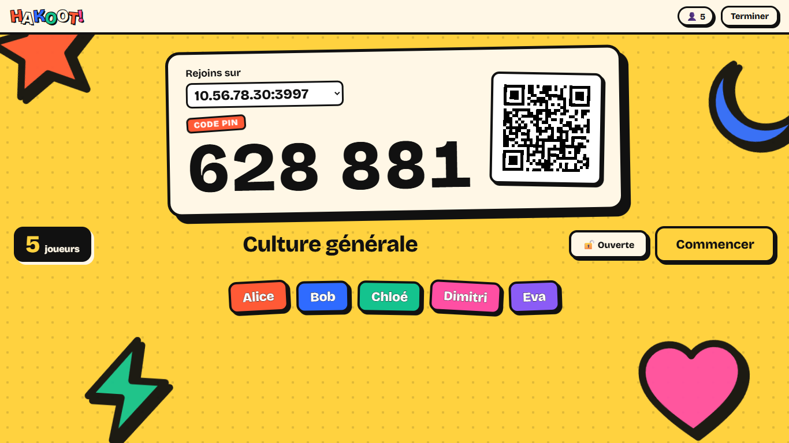
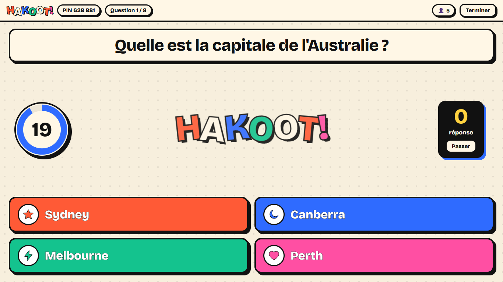
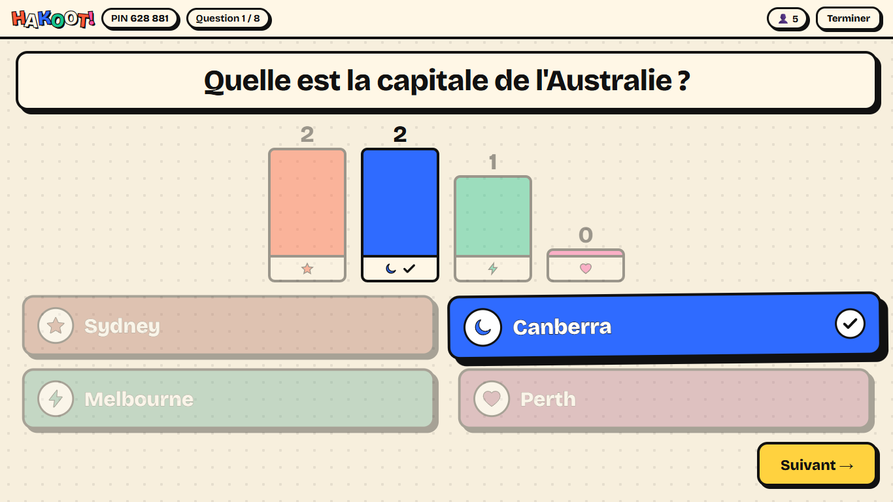
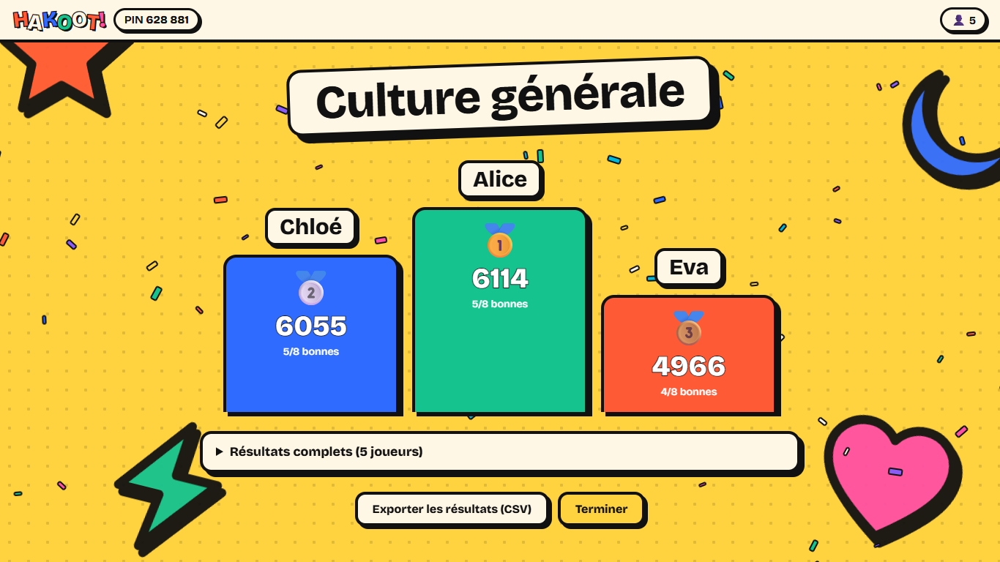
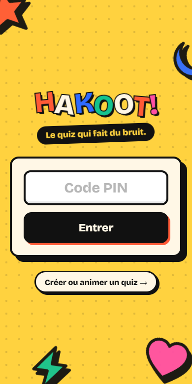
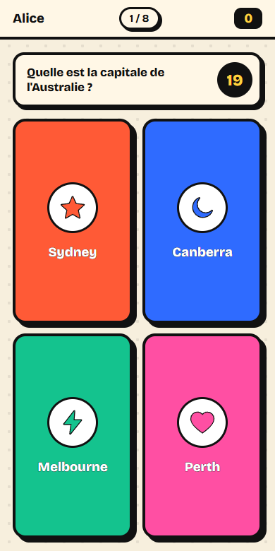
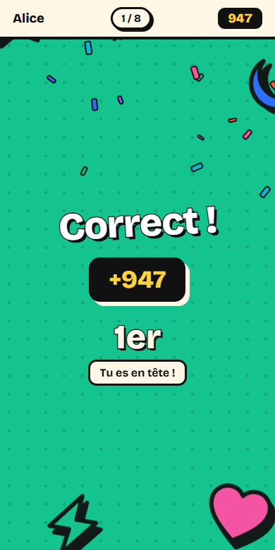

# Hakoot!

[](https://github.com/Siruuis/hakoot/actions/workflows/ci.yml)
[](https://github.com/Siruuis/hakoot/releases/latest)
[](LICENSE)

**Le quiz multijoueur qui fait du bruit.** L'hôte projette les questions sur grand écran, les joueurs répondent depuis leur téléphone avec un code PIN. Open source, auto-hébergé, sans compte, sans pub.



| Question | Résultats | Podium |
| --- | --- | --- |
|  |  |  |

| Accueil (mobile) | Réponse (mobile) | Bonne réponse (mobile) |
| --- | --- | --- |
|  |  |  |

## Fonctionnalités

- **Éditeur de quiz** : questions à 2-4 réponses (une ou plusieurs bonnes) ou vrai/faux, image par URL, chrono de 5 s à 4 min, points standard, doublés ou nuls. Sauvegarde automatique dans le navigateur, import/export JSON.
- **Lobby** : code PIN à 6 chiffres, QR code, choix de l'adresse réseau, exclusion d'un joueur, verrouillage de la partie.
- **Partie en direct** : annonce de la question, chrono synchronisé, fin anticipée quand tout le monde a répondu, graphique des réponses, classement, podium animé.
- **Score** : jusqu'à 1000 points selon la rapidité, plus un bonus de série (jusqu'à +500).
- **Robuste** : reconnexion automatique des joueurs et de l'hôte (même après un rechargement de page), serveur autoritaire (la bonne réponse n'est jamais envoyée aux joueurs avant la fin du chrono).
- **Export** des résultats en CSV (compatible Excel).
- **API REST + serveur MCP** : une IA comme Claude crée un quiz complet en une phrase et te donne un lien qui lance la partie.

## Démarrage rapide

Prérequis : [Node.js](https://nodejs.org) 20.19 ou plus récent.

**Avec la release** (rien à compiler) : télécharge `hakoot-vX.Y.Z.zip` depuis les [releases](https://github.com/Siruuis/hakoot/releases/latest), décompresse, puis `npm ci --omit=dev` et `npm start`.

**Depuis les sources** :

```bash
git clone https://github.com/Siruuis/hakoot.git
cd hakoot
npm install
npm run build
npm start
```

Ouvre `http://localhost:3000/create`, lance un quiz, puis fais scanner le QR code aux joueurs (ils doivent être sur le même réseau Wi-Fi). Le port se change avec la variable d'environnement `PORT`.

> Sous Windows, autorise Node.js dans le pare-feu (réseau privé) au premier lancement, sinon les téléphones ne pourront pas se connecter.

## Créer des quiz avec une IA (MCP)

Lance le serveur, puis ouvre [Claude Code](https://claude.com/claude-code) dans le dossier du projet : le serveur MCP `hakoot` (fichier `.mcp.json`) et la skill `hakoot-quiz` sont détectés automatiquement. Demande simplement :

> Crée un quiz Hakoot de 10 questions sur la Rome antique

Claude renvoie un lien `http://localhost:3000/launch/<id>` qui crée la partie. Le quiz apparaît aussi dans **Mes quiz → Quiz du serveur**.

Pour les autres clients (Claude Desktop, scripts), l'accès distant avec clé API et la référence complète : **[docs/API.md](docs/API.md)**.

## Développement

```bash
npm run dev               # serveur (port 3000) + Vite avec rechargement à chaud (port 5173)
npm test                  # toute la batterie de tests
npm run test:unit         # validation, moteur de jeu, stockage, authentification
npm run test:integration  # Socket.IO, API, MCP, charge (150 joueurs)
npm run test:ui           # parties jouées dans un vrai navigateur (Chrome/Edge, CHROME_PATH)
npm run key               # génère une clé API dans .env
```

## Architecture

```
server/   Express + Socket.IO : moteur de jeu, API REST, MCP HTTP, stockage des quiz
mcp/      serveur MCP stdio (Claude Desktop, autres clients)
shared/   validation des quiz, partagée client/serveur
src/      client React (Vite) : accueil, éditeur, écran hôte, écran joueur
test/     tests unitaires, d'intégration, de charge et d'interface
```

Les parties vivent en mémoire côté serveur. Les quiz de l'éditeur sont stockés dans le `localStorage` de l'hôte, ceux créés par l'API dans `data/quizzes.json`.

## Releases

Chaque tag `vX.Y.Z` déclenche le workflow de release : tests, build, puis publication d'une archive prête à l'emploi. Voir le [CHANGELOG](CHANGELOG.md).

### Format d'import JSON

```json
{
  "title": "Mon quiz",
  "description": "",
  "questions": [
    {
      "type": "quiz",
      "text": "Quelle est la capitale de l'Australie ?",
      "image": "",
      "answers": ["Sydney", "Canberra", "Melbourne", "Perth"],
      "correct": [1],
      "timeLimit": 20,
      "points": 1000
    }
  ]
}
```

`type` : `quiz` ou `truefalse` · `timeLimit` : 5, 10, 20, 30, 45, 60, 90, 120 ou 240 · `points` : 0, 1000 ou 2000.

## Contribuer

Les issues et pull requests sont les bienvenues. Lance `npm test` et `npm run build` avant de proposer une modification.

## Licence

[MIT](LICENSE)
